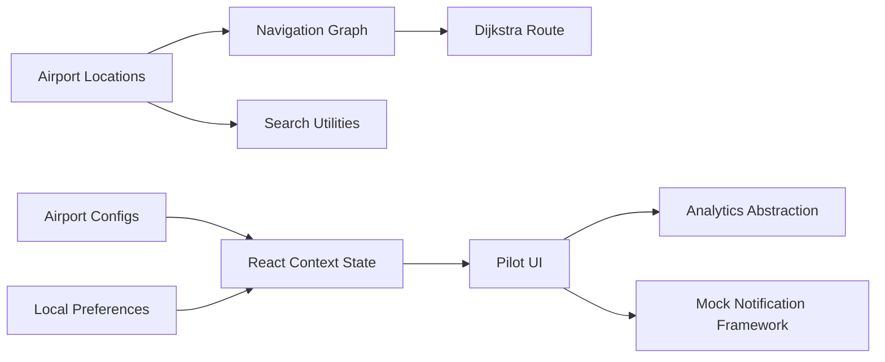

# Beacon Architecture

## Overview

Beacon is organized around pilot-ready airport configuration and traveler-aware navigation. The app currently runs entirely client-side with mock data and local persistence, but the boundaries are designed so real airport APIs, indoor positioning, cloud sync, and administrative tools can be added later.

## Key Layers

- `src/data/airports`: pilot airport configuration for GSP, AVL, and CLT.
- `src/context`: centralized application state for airport, traveler mode, destination, route, preferences, favorites, pins, and notifications.
- `src/utils/pathfinder.ts`: graph builder and Dijkstra pathfinding.
- `src/utils/search.ts`: fuzzy search, synonyms, category, keyword, gate, and traveler-mode ranking.
- `src/services`: local storage, analytics abstraction, and notification scaffolding.
- `src/components`: feature components and small reusable UI primitives.

## Future Integration Points

- Replace generated graph edges with airport-provided indoor graph data.
- Add A* and real-time rerouting on top of the `Route` contract.
- Replace local storage with authenticated cloud sync.
- Register a production service worker for offline maps and search.
- Connect analytics and notification services to approved providers.
