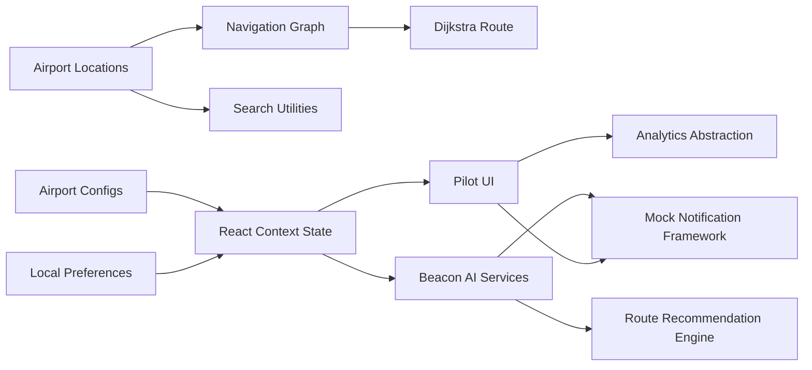

# Beacon Architecture

## Overview

Beacon is organized around pilot-ready airport configuration and traveler-aware navigation. The app currently runs entirely client-side with mock data and local persistence, but the boundaries are designed so real airport APIs, indoor positioning, cloud sync, and administrative tools can be added later.

## Key Layers

- `src/data/airports`: pilot airport configuration for GSP, AVL, and CLT.
- `src/context`: centralized application state for airport, traveler mode, destination, route, preferences, favorites, pins, and notifications.
- `src/utils/pathfinder.ts`: graph builder and Dijkstra pathfinding.
- `src/utils/search.ts`: fuzzy search, synonyms, category, keyword, gate, and traveler-mode ranking.
- `src/services`: local storage, analytics, AI recommendation, route recommendation, notification, favorites, recent destination, auth, admin, and API abstractions.
- `src/components`: feature components and small reusable UI primitives.

## Future Integration Points

- Replace generated graph edges with airport-provided indoor graph data.
- Add A* and real-time rerouting on top of the `Route` contract.
- Replace local storage with authenticated cloud sync.
- Register a production service worker for offline maps and search.
- Connect analytics and notification services to approved providers.

## Sprint 4 Enterprise Additions

- `src/utils/smartRouting.ts`: route-option scoring and condition-aware recommendations.
- `src/services/apiClient.ts`: API abstraction with cache and retry support.
- `src/services/enterpriseServices.ts`: mock airport, flight, alert, and directory service facade.
- `src/services/notifications.ts`: contextual notification generation.
- `src/services/voice.ts`: text-to-speech queue scaffolding.
- `src/data/enterprise.ts`: route labels, map layers, conditions, flights, alerts, services, translations, and feature flags.

## Sprint 6 AI Intelligence Additions

- `src/services/BeaconAI.ts`: central intelligence facade for suggested routes, destinations, breaks, quiet areas, dining, restrooms, exits, congestion, travel time, stress scoring, and dashboard recommendation cards.
- `src/services/RouteRecommendationEngine.ts`: profile-aware route recommendation service returning recommended and alternative routes, estimated time, accessibility notes, crowd level, and noise level.
- `src/services/travelerProfiles.ts`: typed traveler profile preferences for Veteran PTSD, Wheelchair, Family, Business Traveler, Sensory Sensitive, and International modes.
- `src/services/NotificationCenter.ts`: smart notification creation, sorting, unread filtering, and read-state handling.
- `src/services/FavoritesService.ts` and `src/services/RecentDestinationsService.ts`: local persistence boundaries for saved and recent locations.
- `src/services/airportIntelligence.ts`: mocked crowd, construction, closure, security wait, restaurant wait, parking, weather, crowd, and noise intelligence.

## Sprint 7 Operations Intelligence Additions

- `src/types/UserRole.ts`: enterprise role model for Traveler, Airport Operations, Guest Services, Accessibility Coordinator, Airport Administrator, Emergency Response, and Demo Mode.
- `src/context/UserRoleContext.tsx` and `src/hooks/useUserRole.ts`: local role state and development/demo role switching.
- `src/pages/OperationsDashboard.tsx`: lazy-loaded role-based operations workspace composed from reusable widgets.
- `src/services/DemoDataGenerator.ts`: deterministic demo data for 500 travelers, 50 staff, 100 notifications, 25 incidents, 100 destinations, crowd levels, and heatmaps.
- `src/services/EventSimulationService.ts`: live mock airport event generation for demo mode.
- `src/services/AirportAlertsService.ts`: alert aggregation for static airport alerts and simulated high-priority events.
- Operations components stay modular: `CrowdHeatmap`, `AnalyticsDashboard`, `IncidentCenter`, `AccessibilityDashboard`, `TaskQueue`, and `NotificationTimeline`.
- Performance updates include lazy loading the enterprise dashboard, React.memo around dashboard panels, and memoized dashboard/search selectors.

## Sprint 8 Executive Demo Additions

- `src/pages/LandingPage.tsx`: enterprise SaaS-style executive overview with mission, benefits, AI features, dashboard preview, and demo calls to action.
- `src/pages/DemoMode.tsx`: guided presenter scenario engine for veteran, wheelchair, family, low-vision, business, senior, first-time visitor, and operations scenarios.
- `src/components/GuidedTour.tsx`: Guided Tour component with dismissible and restartable product tour steps across dashboard, navigation, profiles, AI, favorites, accessibility, operations, notifications, and analytics.
- `src/theme/designSystem.ts` and `src/theme/animations.ts`: Design System tokens and shared motion helpers for consistent enterprise polish.
- `src/services/ErrorService.ts`: centralized error capture for unexpected exceptions, network simulation, invalid routes, missing data, component failures, and storage errors.
- `src/components/LoadingStates.tsx`: skeleton cards, progress indicators, dashboard, map, analytics, search, and notification loaders.
- `src/components/AboutBeacon.tsx`: footer branding, version information, copyright placeholder, and about screen.
- Performance improvements include continued lazy loading for the enterprise operations dashboard, memoized scenario/destination selection, reduced-motion-aware animations, and modular presentation pages.
